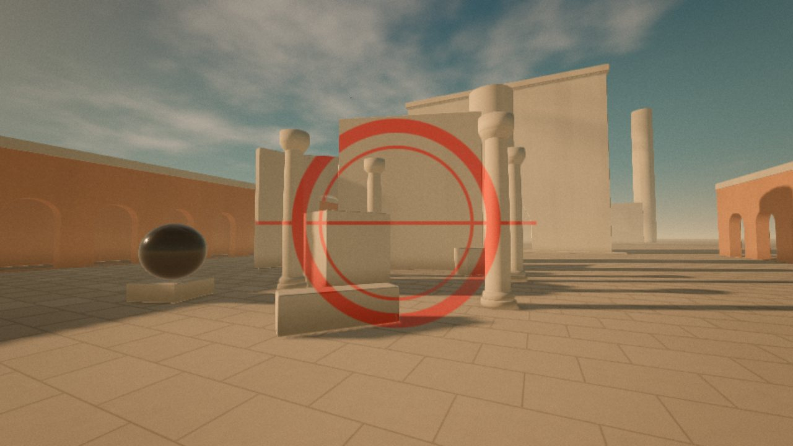
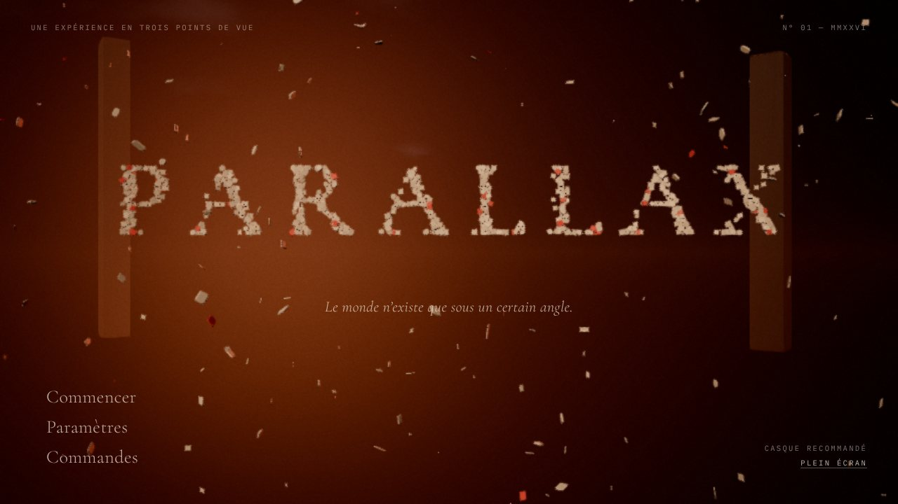
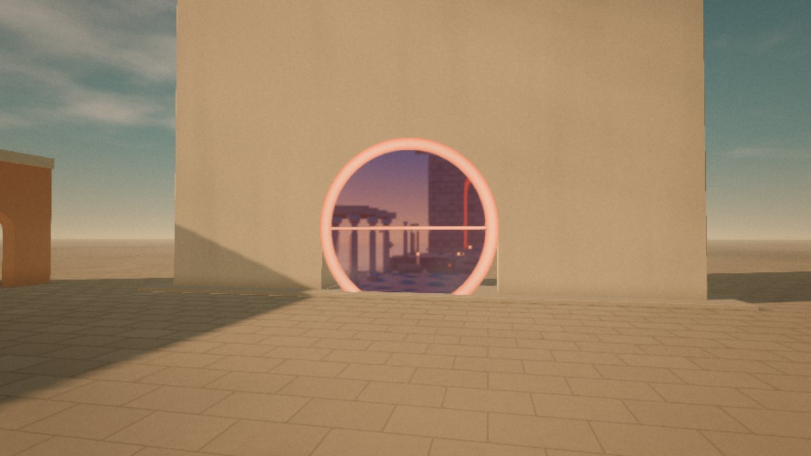
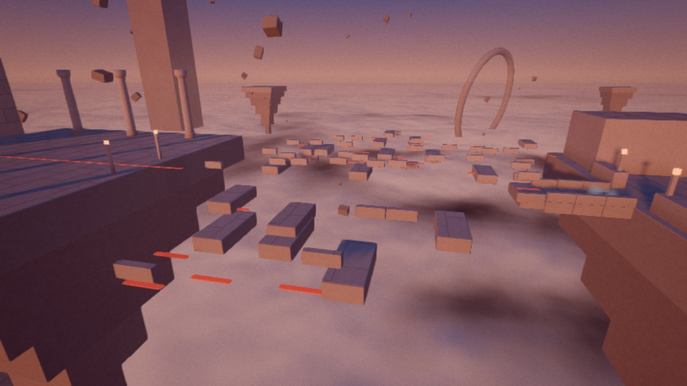
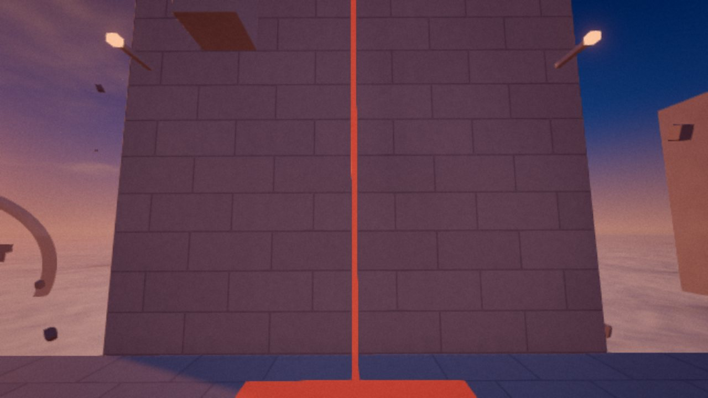
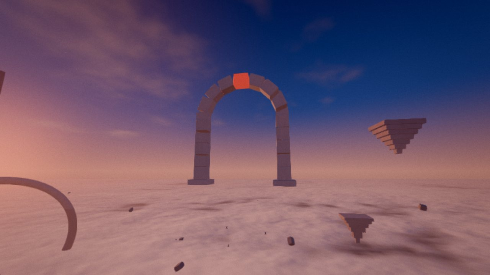
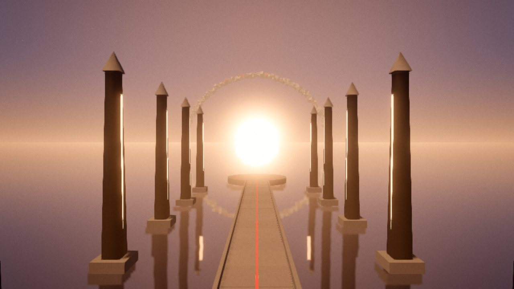

# PARALLAX

> *Le monde n'existe que sous un certain angle.*

**PARALLAX** est une expérience 3D interactive pour navigateur. On y entre à la première personne
dans un monde métaphysique (à la croisée de De Chirico, Varini et Escher) brisé en fragments qui ne
prennent sens que depuis **un seul point de vue**. Trouver ce point de vue — en regardant, en
écoutant — rend réel ce que l'on perçoit : un cercle peint devient un anneau de lumière, des pierres
suspendues deviennent un pont, une paroi devient un sol, deux images de l'horizon n'en font plus qu'une.

Trois chapitres, de l'après-midi doré à l'aube, environ **4 à 8 minutes**, puis exploration libre.
Tout — géométries, matières, lumière, musique, sons — est **généré en temps réel** par le code :
aucune image, aucun modèle 3D, aucun fichier audio, aucun service en ligne.



| | |
|---|---|
|  |  |
|  |  |
|  |  |

---

## 1. Lancer PARALLAX sur Windows 11

Aucune installation n'est nécessaire : l'application complète tient dans **un seul fichier**,
`dist/PARALLAX.html` (≈ 0,9 Mo).

**Méthode recommandée**
1. Téléchargez ou clonez le dépôt (bouton *Code → Download ZIP* sur GitHub, puis *Extraire tout*).
2. Double-cliquez sur **`Lancer PARALLAX.bat`**. Le lanceur ouvre le fichier dans Google Chrome
   (ou, à défaut, dans votre navigateur par défaut).
3. Cliquez sur **« Entrer »** (le son s'active à ce moment-là, c'est une règle des navigateurs),
   puis sur **« Commencer »**.

**Alternative** : faites glisser `dist/PARALLAX.html` dans une fenêtre de Chrome, ou clic droit →
*Ouvrir avec* → *Google Chrome*. Microsoft Edge (moteur Chromium) fonctionne aussi.

> Windows peut afficher un avertissement SmartScreen pour le fichier `.bat` (fichier téléchargé).
> Il ne fait qu'ouvrir `dist\PARALLAX.html` dans Chrome ; vous pouvez aussi ouvrir le fichier HTML
> directement.

### Pour la meilleure expérience sur l'ASUS Vivobook 17 (i7‑1255U, Iris Xe)
* **Branchez l'ordinateur sur secteur** et choisissez *Paramètres Windows → Système → Alimentation →
  Mode d'alimentation : Meilleures performances*. Sur batterie, le GPU intégré est fortement bridé.
* Dans Chrome : *Paramètres → Système → « Utiliser l'accélération graphique si disponible »* doit être
  activé (c'est le cas par défaut).
* Passez en **plein écran** (F11, ou le bouton « Plein écran » de l'écran-titre) et utilisez un **casque**.
* Le profil graphique **« Équilibrée »** est choisi automatiquement pour un GPU Intel intégré. Si
  l'image saccade, passez en **« Performances »** dans *Paramètres → Graphismes*.
* Le premier chargement compile les shaders (quelques secondes, barre de progression).

---

## 2. Commandes

| Action | Clavier / souris | Manette |
|---|---|---|
| Se déplacer | **Z Q S D** (AZERTY) / **W A S D** (QWERTY) ou flèches | Stick gauche |
| Regarder | Souris (cliquer dans l'image pour capturer le pointeur) | Stick droit |
| **Observer** | **Clic maintenu** (gauche ou droit), **Espace** ou **E** | A ou gâchette |
| Courir | Maj | Bouton L / stick gauche enfoncé |
| Pause, paramètres | Échap (ou P) | Start |
| Plein écran | F11 | — |

Les touches sont lues par leur **position physique** : ZQSD sur AZERTY et WASD sur QWERTY
fonctionnent sans réglage, et l'interface affiche les bonnes lettres.

**Le principe** : chaque figure vermillon ne se recompose que depuis un point de vue unique (repéré
par un disque de bronze au sol). Approchez-vous et **écoutez** : un accord se désaccorde quand vous
êtes loin et devient pur au bon endroit. L'arc autour du réticule et la cote « ALIGNEMENT » indiquent
la justesse du regard. Au bon endroit, **maintenez le clic pour observer** : le regard se fixe et le
monde se transforme.

---

## 3. Déroulement (attention, divulgâcheur)

<details>
<summary>Afficher le déroulement</summary>

* **Titre** — le mot PARALLAX est fait d'éclats de pierre dispersés en profondeur ; il n'est lisible
  que depuis la caméra (bougez la souris pour le voir se disloquer).
* **I — Le Seuil** (après-midi doré). Une place métaphysique ; un emblème vermillon (cercle + horizon)
  est peint en éclats sur colonnes, murs et sol. Depuis le belvédère, il se recompose. Le verrouiller
  détache la peinture en anneau de lumière, enfonce l'architecture dans le sol et ouvre une porte de
  lune dans la Grande Porte, vers…
* **II — L'Archipel** (heure bleue). Des îles de pierre au-dessus d'une mer de nuages. Des pierres
  suspendues forment un pont depuis une terrasse ; une ligne vermillon mène au pied d'un monolithe de
  100 m… dont la paroi devient le sol. Au sommet, une arche géante s'assemble dans le ciel et la nuit tombe.
* **III — Le Point de fuite** (nuit → aube). Une chaussée sur une eau-miroir, entre des obélisques qui
  s'allument à votre passage. Deux anneaux décalés — comme une vision double — convergent à mesure que
  vous avancez. Au bout, le regard les fait fusionner : l'aube remonte la chaussée en musique et l'anneau
  et son reflet composent l'emblème du début. Générique, puis exploration libre.

</details>

Des **indices** discrets apparaissent si vous semblez chercher (désactivables). Tomber dans le vide
vous ramène simplement au dernier sol sûr. La progression est **sauvegardée par chapitre**
(« Continuer » et sélection de chapitre sur l'écran-titre).

---

## 4. Options

### Profils graphiques (*Paramètres → Graphismes*)

| | Élevée | **Équilibrée** (Iris Xe) | Performances |
|---|---|---|---|
| Résolution interne | 100 % (adaptative 75–100 %) | 85 % (adaptative 65–100 %) | 70 % (adaptative 50–85 %) |
| Anticrénelage | MSAA 4× | FXAA | FXAA |
| Ombres | 2048 px, douces | 2048 px, douces | 1024 px |
| Bloom | 6 niveaux | 5 niveaux | 4 niveaux |
| Reflets de l'eau (III) | ½ résolution | 35 % | 25 % |
| Portails | 60 % | 50 % | 40 % |
| Particules / éclats | 100 % | 70 % | 45 % |
| Relief des pierres | oui | oui | non (au prochain chapitre) |
| Aberration chromatique | oui | oui | non |

Autres réglages : **résolution adaptative** (ajuste la résolution pour tenir la fréquence cible),
**résolution interne** de base, **fréquence cible** 60 ou 30 i/s, **affichage des performances**
(i/s, résolution, appels de dessin).

### Commandes, audio, confort
Sensibilité de la souris, inversion de l'axe vertical, champ de vision (55–95°) ; volumes général,
musique, effets ; balancement de la tête, **mouvements réduits** (atténue secousses, roulis et
variations de focale), indices.

Les réglages et la progression sont enregistrés dans le navigateur (localStorage).

---

## 5. Structure du projet

```
├── dist/PARALLAX.html        Application complète, autonome (à ouvrir dans Chrome)
├── Lancer PARALLAX.bat       Lanceur Windows
├── index.html                Point d'entrée de développement
├── src/
│   ├── main.ts               Démarrage
│   ├── app/                  Application : boucle, états, transitions, réglages, réalisateur (caméra)
│   ├── render/               Rendu : renderer, post-traitement HDR, atmosphère, matériaux étendus,
│   │                         textures procédurales, profils graphiques
│   ├── world/                Briques du monde : ciel, nuages, eau, portails, anamorphoses (peinte
│   │                         et d'éclats), emblème, particules, oiseaux, constructeur d'architecture
│   ├── stages/               Scènes : titre, I Le Seuil, II L'Archipel, III Le Point de fuite
│   ├── player/               Joueur : contrôleur, collisions, référentiels de gravité, entrées
│   ├── audio/                Moteur Web Audio, instruments synthétiques, partition générative
│   ├── ui/                   Interface (DOM + CSS), polices embarquées
│   └── util/                 Mathématiques, chronologies de séquences
├── tests/                    Tests automatisés (Playwright) — voir § 6
└── docs/
    ├── CONCEPTION.md         Document de conception (direction artistique, mécaniques, architecture)
    ├── RAPPORT_TESTS.md      Rapport des tests réellement effectués
    └── images/               Captures
```

### Développement
Prérequis : [Node.js](https://nodejs.org) 20 ou plus récent.
```bash
npm install          # dépendances (three, vite, typescript…)
npm run dev          # serveur de développement : http://localhost:5173
npm run build        # reconstruit dist/PARALLAX.html (fichier unique)
npm run typecheck    # vérification TypeScript
```
Paramètres d'URL utiles en développement : `?dev=threshold|archipelago|vanishing|title` (accès direct
à une scène), `&quality=high|balanced|performance`, `&fps` (compteur), `&fixed` (résolution fixe).

---

## 6. Tests

Les tests pilotent un vrai navigateur Chromium (rendu WebGL logiciel SwiftShader) sur le build final :
```bash
npm run build && npx vite preview --port 4173 &
BASE=http://localhost:4173/PARALLAX.html node tests/playthrough.mjs   # parcours complet (11 étapes)
AUDIO=1 BASE=http://localhost:4173/PARALLAX.html node tests/playthrough.mjs  # idem, audio actif
node tests/ui-flow.mjs        # interface avec de vrais clics (chargement → titre → réglages → jeu → pause)
node tests/audio-mix.mjs      # niveaux sonores (RMS / crête) aux moments clés
node tests/gallery.mjs        # vues de contrôle + appels de dessin / triangles
```
Le détail des résultats, de ce qui a été vérifié et de ce qui **n'a pas pu l'être** est dans
[docs/RAPPORT_TESTS.md](docs/RAPPORT_TESTS.md).

---

## 7. Limitations connues (honnêtes)

* **Performances sur l'Iris Xe non mesurées.** L'environnement de développement n'a pas de GPU :
  le rendu y était logiciel. Les profils, la résolution adaptative et les budgets (16 à 32 appels de
  dessin par image, ombres recalculées seulement quand quelque chose bouge) visent 60 i/s sur un GPU
  intégré, avec repli automatique de la résolution ; mais la fluidité réelle reste à confirmer sur la
  machine. En cas de saccades : profil « Performances », fréquence cible 30 i/s.
* **Premier chargement** : la compilation des shaders sous Windows (Direct3D via ANGLE) peut prendre
  plusieurs secondes.
* **Son** : la synthèse et le mixage ont été vérifiés par mesure (niveaux, absence d'écrêtage), pas à
  l'oreille sur votre matériel ; le rendu dépend du casque ou des haut-parleurs.
* **Capture du pointeur** : si le navigateur la refuse, un mode « glisser pour regarder » prend le relais.
  Un pavé tactile fonctionne, une souris est plus confortable.
* **Manette** : prise en charge standard (Gamepad API), non testée sur une manette réelle.
* **Perte du contexte graphique** (veille, changement d'écran, pilote) : un message propose de
  recharger ; la progression par chapitre est conservée.
* Écran tactile et mobiles : non pris en charge (expérience conçue pour clavier + souris).
* Interface en français uniquement.

---

## 8. Crédits et licences

Conception, direction artistique, programmation, image et son : **Claude (Anthropic)**, à la demande
de l'auteur du dépôt.

* [three.js](https://threejs.org) — licence MIT.
* Polices **Cormorant Garamond** (Christian Thalmann) et **IBM Plex Mono** (IBM) — SIL Open Font License 1.1,
  distribuées via Fontsource, embarquées dans le fichier (sous-ensemble latin).
* Aucune autre ressource externe : pas de musique, d'image, de modèle ni de son tiers.
